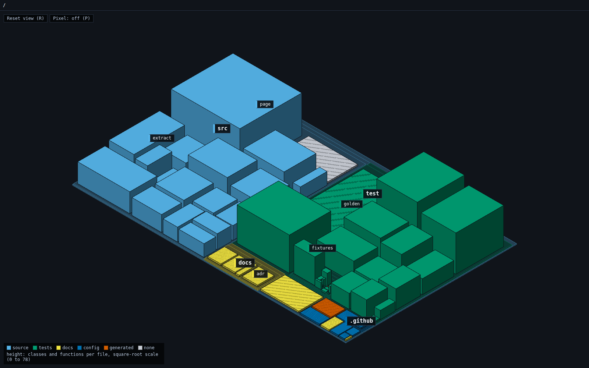

# Rungs

Coding agents now open pull requests of thousands of lines, and someone still has to decide whether to merge them. Reading the diff does not scale, and a summary written by the same agent is a claim, not evidence. Rungs computes a picture of the code itself, a city you can turn and zoom into, so a reviewer can approve a large change the way they would approve a design: by seeing what it touches, and opening the exact source lines behind anything they doubt.



*Rungs drawing its own repository. Blue buildings are source, green are tests, yellow are docs, dark blue is config and orange is generated. Height is the number of classes and functions in a file. Striped buildings are files Rungs cannot analyse yet.*

**The target.** Run one command on a real agent-written change of 10,000 lines or more, and approve or reject it in 15 minutes without opening a diff. To decide, a reviewer needs three answers: what the change claims to do, what it touches that nobody mentioned, and which contracts moved. The test case is [a 14,370-line agent-written pull request](https://github.com/DerekHertz/docviz/pull/18).

The name comes from a ladder of abstraction. Each rung is computed from the one below it: source, then a graph, then pseudocode, then logic, then the picture.

## How it works

1. **Read the checkout.** Rungs lists the files git tracks plus untracked ones not ignored, and reads them from the working tree, so uncommitted changes are included. A symlink reads as its target path, the way git stores it, so nothing outside the checkout leaks in.
2. **Extract a graph.** A pure, deterministic function turns the file tree into a graph of packages, folders, files, classes and functions, each with a line range and a role (source, tests, config, docs or generated). JavaScript and TypeScript go through the TypeScript compiler. No model is called.
3. **Lay out a ground plan.** A squarified treemap places every package, folder and file. The layout depends only on the graph, so neither the camera nor the theme ever moves anything.
4. **Draw a city.** Districts are raised plates and files are buildings, rendered with three.js. Drag to pan, right-drag to turn, scroll to zoom, double-click a district to fly to it. Click a building to read its source, served from the same snapshot the graph came from.
5. **Compare against a base.** `rungs compare <base>` reads the base revision at the merge base, the same base GitHub diffs a pull request against, and extracts both graphs. Every module carries a digest of its text, so the comparison pairs nodes by identity and finds what was added, altered, removed or moved without reading a diff. Unchanged buildings dim, changed ones stay bright, and removed files stand as see-through ghosts you can still open.
6. **Answer the three questions.** A panel beside the city lists the description's claims, the changes no claim covers, and the contracts that moved: exported signatures and the outside resources each function reaches (processes, network, file system, timers), drawn as plates at the edge of the city. Every entry flies the camera to its place and opens its exact lines.


*Rungs reviewing the target pull request. The panel shows which claims the agent linked to code, what reaches the outside world without being mentioned, and the two exported functions whose parameters changed.*

## System design

The architecture borrows from operating systems and distributed systems: Ensemble-style composable layers, a single trusted writer, and consistency models for deciding what to compute and when.

| Decision | Why |
| --- | --- |
| **One stored rung.** Only the graph is stored. Pseudocode, logic and the picture are views computed from it. | There is one source of truth, and every view can be recomputed and traced back to source lines. Nothing drawn can drift from the code. |
| **A single trusted writer.** The extractor is the only module that writes graph facts. It is a pure function from a file tree to a graph, with no model calls. | Facts are reproducible and checkable. A golden graph plus an append-only version ledger make the build fail if extractor output changes without a version bump. |
| **Three tiers of facts, never mixed.** *Derived* facts come from the extractor, *observed* facts from running the code, *claimed* facts from people and agents. | It is a trust boundary. An agent's description of its own change is drawn as a claim, and can attach to the graph but never create or change a node. |
| **Composable layers behind narrow seams**, in the style of Ensemble. A language adapter turns files of one language into nodes and edges, and a theme turns facts into looks. | Each layer can be replaced and tested alone. Adapters only describe declarations, and the extractor alone assigns ids and line numbers, so a new language cannot break identity. Every theme shares one layout, so switching theme moves nothing. |
| **Identity is (level, path, qualified name), never a line number.** | A function keeps its identity when code above it moves, which is what makes a review a comparison of two graphs. The naming scheme is collision-free by construction and is recorded in [ADR 0001](docs/adr/0001-code-node-identity.md). |
| **A comparison is a function of two graphs.** Identity plus a digest per module decides added, altered, removed and moved. A move is paired only when the text is identical. | A rename is never mistaken for a rewrite, and a rewrite is never hidden as a rename. Swapping base and head swaps added with removed, which is checked over 300 generated tree pairs. |
| **Effects are resolved, never matched by name.** A call becomes an effect edge only when the TypeScript binder resolves its callee to an entry in a versioned catalog of runtime built-ins, over an in-memory program with no type definitions from the host. | A local function called `fetch` is not the network, and a shadowing parameter is not the file system. Output stays a pure function of the tree, and a call Rungs cannot resolve is listed as a known gap, not guessed. |
| **Agents may link, never decide.** An agent links each claim in the description to the modules it describes. Links are validated against the comparison, cached outside the repository, and drawn as claimed. | A wrong link can only move a change from "no claim covers it" to "linked by the agent only", where it stays visible. The agent can never hide a change or create a fact. |
| **The pull request is untrusted input.** The base is read through a temporary index and a scratch checkout, never by parsing git's output by content, and the agent sees names, never source text. | A file crafted to look like git's reply framing cannot make another file read wrong, and a description cannot inject into the page or the agent's command. |
| **Lazy release consistency for expensive views.** Pseudocode, narration and call edges are computed when a view first opens them, and ahead of time only for contracts that moved. | Opening a function is the acquire. Nobody pays for analysis of code they never look at, which matters on a change of thousands of lines. Part of the specification, not built yet. |
| **A cache with recorded reads.** Each record lists everything it read, including lookups that found nothing, and is valid only while all of those are unchanged. | An incremental update must equal a build from nothing, byte for byte, which is checked with random edits. Part of the specification, not built yet. |
| **One meaning per visual channel.** Colour shows role, from a colour-blind-safe palette. Height shows classes and functions per file, on a square-root scale. Stripes mark files with no language adapter. | People read only a few features at a glance, and each can carry one message ([research notes](docs/research/visual-understanding-for-review.md)). Stripes follow the rule that Rungs never guesses: what it cannot analyse is shown as exactly that. |

## Try it

From the repository root, with Node 22.18 or later and git:

```sh
npm ci
npm run rungs -- /path/to/a/git/checkout
npm run rungs -- compare main /path/to/a/git/checkout --description pr.md --link
```

The first command builds the graph, starts a local server on 127.0.0.1 and opens the city in your browser. Leave out the path to draw Rungs itself. The second compares the checkout, uncommitted changes included, against its merge base with `main`. Press R to reset the view and P to cycle the pixel-art render mode. Stop the server with Ctrl+C.

`rungs compare <base> [dir]` takes these flags, all optional:

- `--description <file>` reads the pull request's description as claims. Use `-` to read it from stdin.
- `--link` asks the Claude Code CLI, using your own login, to link each claim to the code it describes. It needs `--description`. `--relink` asks again even when a cached answer exists.
- `--walkthrough` asks the agent for a tour of the change, stop by stop. `--rewalk` asks again.
- `--narrate` offers plain-English narration beside each function's pseudocode. `--renarrate` writes it again.
- `--run-tests` runs the base's tests once against the checkout's code, in a sandbox.
- `--run-tests-unsandboxed` does the same without a sandbox, for when none is available.
- `--port <n>` picks the port and `--no-open` skips the browser.

## What the page shows

**Three tiers.** Every fact on the page carries one of three tags. *Derived* facts are computed from the code: the graph, the comparison, the contracts that moved, the pseudocode. *Claimed* facts come from people and agents: the description, the agent's links, the tour, the narration. *Observed* facts come from running the code: test results. The tiers are never mixed, and a claim can attach to the graph but never create or change a node.

**The three questions.** The review panel lists what the description claims (claimed), what changed that no claim covers, and the contracts that moved (both derived).

**Pseudocode.** Open a function and Rungs shows an outline of its control structure, each line linked to its source lines. It is computed when you open the function, from the graph alone.

**Walkthrough.** With `--walkthrough`, an agent orders the changed modules into stops. Each stop shows four columns side by side: what the description expects (claimed), what the agent says, with each sentence anchored to lines (claimed), the source lines with the contract moves and new calls there (derived), and what a test run recorded (observed). What the narration leaves out of the derived facts is noted by code, never by the agent. The agent sees names, signatures and line ranges, never source text.

**Narration.** With `--narrate`, each function offers a Narration toggle: plain-English sentences beside its pseudocode, anchored to its lines and always marked claimed. Functions in contracts moved are narrated ahead of time (at most 30), and a narration is marked stale once the function changes.

**Test results.** With `--run-tests`, Rungs runs the base's tests, not the pull request's, against the pull request's code, so a change cannot loosen, delete or skip a test to make it pass. Tests the pull request wrote or edited run apart and are shown as claimed. What the pull request did to the tests (deleted files, removed tests, `.skip`, `.todo`, `.only`, weaker assertions) is read from the two trees without running anything, and listed as unmentioned. Only `node --test` is run. A project that uses another runner is shown as "tests not run", and a run whose results contradict the runner's exit code is shown as unreliable, with its results withheld.

## The sandbox

`--run-tests` needs a sandbox, which today means Linux with [bubblewrap](https://github.com/containers/bubblewrap) (`bwrap`) installed. Without one, the run is refused and the page says so, unless you pass `--run-tests-unsandboxed`. Those results are labelled "ran without a sandbox: as trustworthy as the PR's author", and the run can reach anything you can.

In the sandbox the tests run in a temporary copy of the tree, with no network, none of your files, a stripped environment and a time limit. Dependencies are fetched first, by npm alone, from the lockfile's registry tarballs with sha512 hashes. Npm runs no install script, and a git, file or other-server dependency refuses the run. The network and the pull request's code are never present together.

The sandbox keeps a hostile change from reading your files or reaching the network while its tests run. It does not make the results trustworthy. The base's tests still import the pull request's code, and that code can fake an outcome from inside the test process. The page says so beside every result: evidence against mistakes, not against a hostile author.

## Verification and design

Run `npm run lint`, `npm run typecheck` and `npm test`. CI runs the same three on every pull request. The tests cover:

- the extractor against a golden fixture, including the version ledger;
- qualified names over 2,070 adversarial inputs, checked to be unique and never empty;
- line counting with CRLF and Unicode line separators, from a single definition of a line;
- layout proportions, the height scale, and the label and fading decisions;
- a server that returns exactly a function's lines;
- comparison properties over generated tree pairs, and goldens for the comparison and the effect catalog;
- reading a base revision, including a file built to imitate git's reply framing;
- the claims, unmentioned and contracts answers, including adversarial descriptions.

Larger features start from two independent design sketches on different models, and every pull request is reviewed by a second model against a stated contract before it merges, for one round or two depending on how much the change decides about what the picture claims. The browser behaviour is checked with scripted headless Chromium runs, including source text compared byte for byte against the file.

- [Specification](SPEC.md): the product contract and the rules every change is held to
- [ADR 0001: code node identity](docs/adr/0001-code-node-identity.md)
- [Research: how people read a picture at a glance](docs/research/visual-understanding-for-review.md)
- [Issues](https://github.com/DerekHertz/rungs/issues): the remaining work, in order
