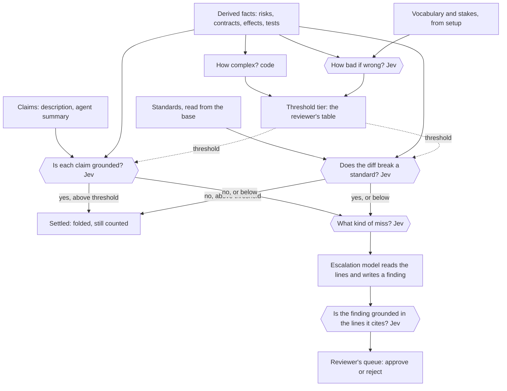

# Jev as a gate: plan

Adopted 2026-11-11. The wording at the end is now in [SPEC.md](../../SPEC.md) (PR 206). The build is
issue 184 and its sub-issues; no gate is built yet.

## The idea

Systems to Streets derives everything it can from code. Some questions code cannot answer exactly:
whether a claim is true of the change, what a file is for, how bad a mistake there would be, whether
a change breaks a written standard. A writing model can answer them, but its sentences can be wrong
in ways nobody can see.

Jev is a classifier. It is given two things that already exist and a typed question, and it returns
a probability. It writes no sentence. This plan puts Jev on the edges between decisions in a review,
so that the reviewer reads source lines only when no gate could settle an item.

**Verification** here means a classifier's answer to "is A grounded in B?", where A and B are both
already in the system. The probability decides where the item goes next.

This has to work on any repository with no hand-written setup. Docviz pull request 14 is the test
case, and nothing in the design may depend on it.

## The flow

Hexagons are Jev. Everything else is code, the reviewer, or a writing model whose output is checked
by Jev before the reviewer sees it.

## Where Jev sits

| Edge | A | B | Question | Click-through |
|---|---|---|---|---|
| Membership | A function or file | A term of the vocabulary | Does this belong to the term? | The term's lines in the repo, the code shown, the probability |
| Stakes | A term | A kind of harm from the catalogue | Could a mistake here cause this harm? | The catalogue entry, the term's members |
| Claim | One claim of the description or summary | The derived changes it is linked to | Is it shown? Is it contradicted? | The claim, the facts and lines shown, both probabilities |
| Standard | One changed hunk, with its base | One written rule | Does the change break this rule? | The rule's lines, the hunk, whether the base already broke it |
| Miss | A failed item | The kinds of miss | Which kind is this? | The item and the answer per kind |
| Finding | A sentence the escalation model wrote | The lines it cites | Is it shown by those lines? | The sentence and the lines |

Every answer records the question, the exact text Jev was given, the probabilities, the threshold
and the model version. An answer is recorded once per comparison, so the page does not change
between loads.

## Vocabulary: what a file is, and why to care

The page should say "this change moves the contract of *sandbox*", not "`run.ts` changed".

1. **Code collects the repository's own words:** headings in its Markdown, folder names, exported
   names, test names, the package description. Each term is pinned to the lines where it appears.
2. **Jev maps code to terms** (the membership edge). A function may belong to several terms or to
   none. A probability in the middle band stays unmapped.
3. **Fallback:** where too little of the code maps to any term, a writing model proposes terms.
   A proposed term is claimed, and Jev still checks every mapping to it.
4. **A file's card** is a fixed template filled with facts: its terms and stakes (judged), its role
   and what rests on it (derived), what the change did to it (derived). This extends issue #176.

Known edge cases, each shown as what it is and never forced: a vague term most of the repo maps to
(dropped by code), synonyms, a name that no longer matches its code, a term in the docs with no
members, and a mapping gone stale because its function changed.

## Stakes

"How bad if wrong?" is judged against a catalogue of kinds of harm that ships with Systems to
Streets, versioned like the effects catalogue, the same for every repository:

- Security, from OWASP's Top 10: access control, cryptography and secrets, injection, insecure
  design, misconfiguration, vulnerable dependencies, authentication, integrity of the supply chain
  and build, logging, server-side request forgery.
- Data loss or corruption, privacy, availability, money, compatibility for callers, what users see.

Code answers first where it can: dependency changes and effects on a process, the file system or
the network are already derived. Jev is asked only about the kinds that need judgement.

## Standards

A repository's written rules are already in the graph as Markdown sections (`AGENTS.md`,
`CONTRIBUTING.md`, style guides). Rules a linter can check stay with the linter. For the rest, Jev
is given the base, the changed hunk and one rule.

- Standards are read from the base, never from the pull request, so a change cannot loosen the
  rule it is judged by.
- The base shows whether a violation is new or was already there.
- A violation is one line on the page: the rule, the hunk, the probability.

## Thresholds and escalation

- Complexity (derived) and stakes (judged) pick a tier from the reviewer's table, for example
  99.9%, 99% or 95%. Higher stakes need Jev to be more sure before an item is settled.
- A settled item folds to one line and stays in its row's count. It is never hidden.
- A miss is classified: ungrounded, contradicted, breaks something, breaks a standard.
- The kind of miss picks the model that reads the lines. Its finding is a claim, and Jev checks it
  against the lines it cites before it reaches the reviewer.
- The reviewer's queue is what is left.

## Setup

`streets setup` runs once per repository: collect the words, measure coverage, fall back to
proposed terms where coverage is low, map code to terms, classify stakes. The reviewer may certify
or correct the result, or skip that; an uncertified vocabulary is marked as drafted. The result is
stored with the cache, outside the repository, so it works on a repository the reviewer cannot
commit to. Later comparisons redo only what changed.

## What has to be true before any gate ships

- **Tested on known cases.** Each edge is a separate question and is adopted on its own, with its
  rate of wrong passes shown beside it on the page.
- **Works without Jev.** With no key, the page is today's page, and each judged mark reads
  "not judged".
- **Source leaves the machine.** Jev is a hosted model, so judged checks send source text to
  TypeSafe. This is off unless the reviewer turns it on.
- **Source is data.** Code under review may contain text written to steer a model. Every question
  is tested with such cases.
- **Cost on the page.** Each run shows what its judged checks cost.

## Build order

Each step names the north-star question it moves.

1. **Claim edge** (claims): each claim of the description judged against its derived changes.
   It needs no vocabulary, so it comes first.
2. **Vocabulary and the file card** (base map): `streets setup`, the membership edge, terms on the
   card from issue #176.
3. **Stakes and thresholds** (contracts moved): the catalogue, the tier table, folding.
4. **Standards edge** (unmentioned): rules from the base against each hunk.
5. **Escalation and the finding edge** (claims): only after 1 to 4 show which misses are common.

## Open questions

- Who sets the default tier table, and what are its defaults?
- Is "what kind of miss?" one Jev question, or can code decide it from which gate failed?
- The walkthrough agent never sees source text today. The escalation model has to. Is that one
  rule with an exception, or two kinds of agent?
- How low must coverage be before proposed terms are used?
- Should certification be storable in the repository as well as in the cache, for teams that own it?

## SPEC wording adopted

**Rule 1**, unchanged. Jev never writes a graph fact.

**Rule 2**, replacing "Three tiers, never mixed":

> **Four tiers, never mixed.** *Derived* facts come from the extractor. *Observed* facts are
> recorded from one run of one tree (test results first). *Claimed* facts come from people and
> agents (descriptions, narration). *Judged* facts are a classifier's answer to a typed question
> about two things already on the page, recorded with the question, what it was shown, its
> probability and the threshold used. Observed, claimed and judged facts attach to graph nodes and
> can never create or change one. The tiers are stored apart and drawn differently.

**A new section, "Judged", under Review:**

> A judged check compares two things that already exist and returns a probability. It writes no
> text. A threshold, chosen by the change's complexity and stakes from the reviewer's table, turns
> the probability into settled, flagged or undecided. A settled item folds to one line and stays in
> its count; nothing judged ever removes a derived fact. Clicking a judged mark shows the question,
> what the classifier was shown and its answer. A check ships only after a test on known cases, and
> its rate of wrong passes is shown beside it. Without a classifier the page shows "not judged".
> Judged checks send source text to a hosted model and are off unless the reviewer turns them on.

**Risks**, adding one sentence after "all derived":

> A judged mark may sit beside a risk, saying how sure a classifier is that it matters; it never
> reorders or removes one.

**A new section, "Vocabulary":**

> A term is a word the repository uses for one of its concepts, taken from its headings, folders,
> exported names and tests, and pinned to those lines. Where these cover too little of the code, a
> model may propose terms, shown as claimed. Whether a module belongs to a term is judged. A module
> may belong to several terms or none. The vocabulary is stored apart from the graph and is marked
> drafted until a person certifies it.

**Surface**, adding:

> `streets setup` builds a repository's vocabulary and stakes once, and stores them with the cache.
